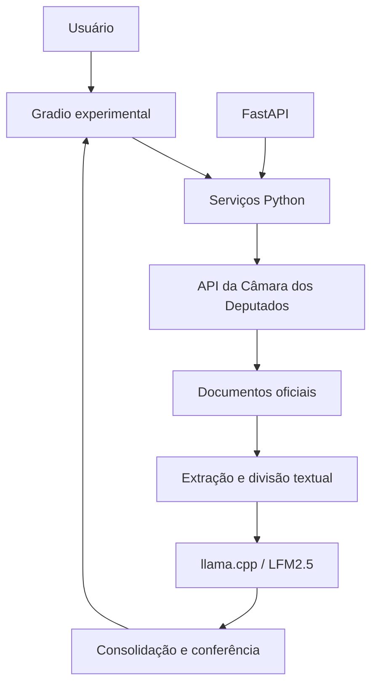

# LiberaAI

O **LiberaAI** é um projeto acadêmico desenvolvido em equipe para a disciplina de **GenAI**, voltado à transparência legislativa brasileira e alinhado à Meta 16.6 dos Objetivos de Desenvolvimento Sustentável (ODS) da ONU.

Seu objetivo é permitir que qualquer cidadão encontre propostas legislativas, acompanhe sua tramitação e compreenda seu conteúdo em linguagem simples, sem precisar dominar termos jurídicos ou conhecer previamente o número de uma proposição.

Atualmente, o protótipo utiliza dados oficiais da Câmara dos Deputados e inteligência artificial executada localmente. A expansão para outras instituições legislativas é uma possibilidade futura.

## Funcionalidades

- Pesquisa de proposições por tipo, número e ano.
- Navegação por deputados e por ano, com filtros, paginação e contagem por autor.
- Consulta de autoria, situação legislativa, tramitações e votações disponíveis.
- Recuperação de documentos oficiais, incluindo peças relacionadas e avulsos.
- Extração de texto de PDFs e processamento de documentos extensos.
- Tela de detalhes com geração automática de explicações e chatbot contextualizado, ainda em validação.
- Laboratório de IA para selecionar documentos, comparar prompts e conferir fontes e métricas.

## Tecnologias

| Tecnologia | Finalidade |
| --- | --- |
| Python 3.12 | Linguagem principal |
| FastAPI e Uvicorn | Backend e servidor HTTP |
| HTTPX e Pydantic | Consultas HTTP e estruturas de dados |
| PyMuPDF | Extração textual de PDFs |
| llama.cpp | Execução local da inteligência artificial |
| LFM2.5-2.6B.Q4_K_M.gguf | Modelo generativo quantizado |
| Gradio 6.32.0 | Interface experimental |
| uv e Pytest | Dependências e testes |
| Jupyter (kernel) | Experimentos e análises |

## Como a inteligência artificial funciona

O projeto utiliza o modelo **LFM2.5-2.6B**, da Liquid AI, em formato GGUF e quantização **Q4_K_M**, executado pelo `llama-server` em CPU. A quantização reduz o consumo de recursos e permite experimentar a inferência em computadores sem GPU dedicada. Não são utilizadas APIs externas de IA.

A estratégia consiste em recuperar a fonte oficial, extrair seu texto, dividir documentos que excedam o contexto disponível e consolidar as respostas. O cliente local utiliza um contexto de 4.096 tokens, com reserva de saída de 1.024 tokens na configuração experimental documentada.

Foram desenvolvidas duas versões de instruções (prompts) para o mesmo modelo. A v2, utilizada na análise comum, solicita evidências textuais e referências às páginas. A conferência local sinaliza possíveis omissões, números sem apoio e citações incompatíveis. Esses mecanismos não garantem fidelidade factual.

O chatbot utiliza informações oficiais e o contexto da proposição selecionada. A interface experimental permite comparar v1 e v2 sob demanda. Não houve treinamento próprio, fine-tuning, RAG ou uso de embeddings.

## Arquitetura



O Gradio utiliza diretamente os serviços Python existentes. O FastAPI possui inicialização independente e deverá ser preparado para a integração com o frontend definitivo.

## Instalação e execução

### Pré-requisitos

- Windows e PowerShell (ambiente utilizado nos testes).
- `uv` e Python 3.12 (versão testada: 3.12.14).
- Binário portátil do `llama-server` e suas DLLs compatíveis.
- Arquivo `LFM2.5-2.6B.Q4_K_M.gguf`, obtido separadamente.
- Acesso à internet para consultar os dados oficiais.

Na raiz do repositório:

```powershell
uv venv --python 3.12.14 .venv
uv sync --locked
Copy-Item .env.example .env
```

Configure no `.env` os caminhos do executável e do modelo GGUF, além dos parâmetros locais conforme o arquivo de exemplo. Não sobrescreva um `.env` existente. O modelo, os binários e o ambiente virtual não devem ser versionados.

### Terminal 1 — IA local

```powershell
.\.venv\Scripts\python -m app.ai.cliente serve
```

### Terminal 2 — Interface Gradio

```powershell
.\.venv\Scripts\python -X utf8 -m app.interface.painel
```

Acesse [http://127.0.0.1:7860/](http://127.0.0.1:7860/) ou a porta indicada no terminal.

### Terminal 3 — FastAPI (opcional para o Gradio)

```powershell
.\.venv\Scripts\python -m uvicorn app.main:app --host 127.0.0.1 --port 8000
```

- [Swagger UI](http://127.0.0.1:8000/docs)
- [Verificação de saúde](http://127.0.0.1:8000/health)

### Testes

```powershell
.\.venv\Scripts\python -m pytest -q
.\.venv\Scripts\python -m pytest -m live -qs -p no:cacheprovider
```

O último relatório técnico registrou **84 testes locais e 6 testes com consultas reais à Câmara aprovados**. A aprovação técnica não implica aprovação da qualidade das respostas da IA.

## Estrutura do projeto

```text
liberaai/
├── app/
│   ├── ai/             # Modelo local, cliente e instruções
│   ├── analysis/       # Processamento, consolidação e conferência
│   ├── core/           # Configurações
│   ├── documents/      # Recuperação e extração documental
│   ├── integrations/   # Integração com fontes oficiais
│   ├── interface/      # Interface experimental e chatbot
│   └── main.py         # Entrada do FastAPI
├── docs/               # Relatórios e documentação técnica
├── notebooks/          # Experimentos
├── tests/              # Testes automatizados
├── AGENTS.md           # Convenções de desenvolvimento
├── .env.example        # Exemplo de configuração
├── pyproject.toml      # Dependências e configurações
└── uv.lock             # Versões das dependências
```

## Estado atual e próximas etapas

As etapas de configuração, integração com a Câmara, execução local da IA, recuperação documental e implementação experimental do Gradio foram realizadas. O projeto está na **Etapa 08 — Validação geral**, antes da entrega definitiva do núcleo funcional.

### Pendências prioritárias — validação e refinamento

- [ ] Melhorar a fidelidade e a clareza das explicações, preservando sujeitos, condições, exceções, valores e prazos.
- [ ] Verificar a conclusão da geração automática na tela de detalhes, com estados de carregamento, falha e nova tentativa.
- [ ] Validar o chatbot com documentos reais e perguntas contextualizadas.
- [ ] Conferir a seleção automática de documentos e o tratamento de versões concorrentes.
- [ ] Implementar ou confirmar a paginação numérica dinâmica, com até cinco números visíveis.
- [ ] Concluir a avaliação humana da interface, da IA e dos documentos extensos.

### Continuidade do desenvolvimento

- [ ] Normalizar os dados e definir os contratos da API para o frontend.
- [ ] Otimizar o backend, o cache temporário e o controle de concorrência.
- [ ] Desenvolver o frontend definitivo, responsivo e acessível.
- [ ] Integrar o frontend aos serviços do backend e da IA local.
- [ ] Realizar testes completos de integração, desempenho, segurança e usabilidade.
- [ ] Definir infraestrutura, revisar licenças das dependências e preparar a implantação.
- [ ] Consolidar a documentação e a apresentação acadêmica da disciplina.

A integração com Senado, ALEPE, ALBA e outras fontes, assim como autenticação e armazenamento persistente, não fazem parte da implementação atual.

## Limitações conhecidas

- O modelo pode omitir informações ou alterar o sentido de passagens legislativas, mesmo com mecanismos de conferência.
- Os experimentos realizados ainda não demonstram melhoria geral de fidelidade da v2 em relação à v1.
- A inferência em CPU pode demorar; documentos extensos exigem processamento adicional.
- PDFs digitalizados sem camada textual não são tratados por OCR. O sistema procura alternativas oficiais e identifica quando a análise se limita à ementa ou a um recorte.
- Os dados dependem da disponibilidade das fontes oficiais. As explicações não substituem o documento legislativo original.

## Fontes e documentação técnica

- [Dados Abertos da Câmara dos Deputados](https://dadosabertos.camara.leg.br/)
- [Documentação da API da Câmara](https://dadosabertos.camara.leg.br/swagger/api.html)
- [Integração com a Câmara](docs/camara_api.md)
- [Extração documental](docs/extracao_documentos.md)
- [Experimento com IA local](docs/experimento_local.md)
- [Guia da interface experimental](docs/interface_experimental.md)
- [Refinamento e avaliação da IA](docs/refinamento_ia.md)
- [Convenções de desenvolvimento](AGENTS.md)

---

**LiberaAI — Inteligência artificial generativa a serviço da compreensão e da transparência legislativa.**

Projeto acadêmico da disciplina de GenAI, em desenvolvimento colaborativo.
